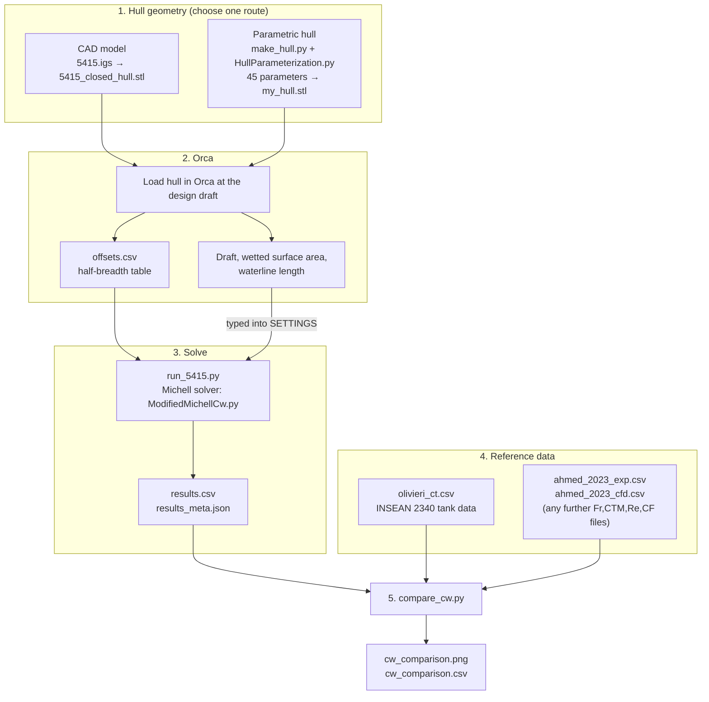

# Michell Thin-Ship Wave Resistance for DTMB 5415 Hull Types

This repository evaluates the wave-making resistance of a modified DTMB 5415 model hull with Michell's thin-ship integral, implemented in Python. The numeric predictions are compared against towing-tank experiments and CFD results over a range of Froude numbers.
---

## Table of Contents

- [How it works](#how-it-works)
- [Repository layout](#repository-layout)
- [Quick start](#quick-start)
- [Inputs](#inputs)
- [Outputs](#outputs)
- [Results](#results)
- [Notes and limitations](#notes-and-limitations)
- [Credits](#credits)

---

## How it works


1. **Build the hull** by one of two routes:
   - **CAD route:** model the hull in CAD and export a closed hull. 
   - **Parametric route:** set the 45-element parameter vector in `make_hull.py` and run it. `HullParameterization.py` creates a closed hull as an STL (`my_hull.stl`).
2. **Load the hull into Orca** At the design draft, read off the draft, wetted surface area and waterline length, and export the half-breadth table as `offsets.csv`.
3. **Run the solver.** For each Froude number, `run_5415.py` calls `ModifiedMichell.py`, which evaluates the Michell wave-resistance integral.
4. **Compare with reference data.** `compare_cw.py` plots and tabulates the Michell wave-resistance predictions (computed by `ModifiedMichellCw.py` and saved in `results.csv`) against three reference data sets: the Olivieri tow tank experiments, and the Ahmed (2023) tow tank and CFD results.
   
### Reference data

| Source | What it provides | File | Status |
|---|---|---|---|
| DTMB 5415 model, INSEAN 2340 (Olivieri et al.) | Measured total resistance coefficient `CTM` vs. Froude number | `olivieri_ct.csv` | Wired into `compare_cw.py` as the main tank curve |
| Ahmed (2023), experiment | `CTM` vs. Froude number, 8 speeds (Fn 0.05–0.39) | `ahmed_2023_exp.csv` | Wired in via `OTHER_EXP_FILES` |
| Ahmed (2023), CFD | `CTM` vs. Froude number, 8 speeds (Fn 0.05–0.39) | `ahmed_2023_cfd.csv` | Wired in via `CFD_FILES` |

All three files share the layout `Fr, CTM, Re, CF`, so more data can be added just by listing another file (see [Settings in `compare_cw.py`](#settings-in-compare_cwpy)).

---

## Repository layout

| File | Purpose |
|---|---|
| `ModifiedMichellCw.py` | Michell solver (`ModMichell`). |
| `run_5415.py` | Main run script. Reads `offsets.csv`, writes `results.csv` and `results_meta.json`. |
| `compare_cw.py` | Compares the Michell prediction with tow tank and CFD data. Writes `cw_comparison.png` and `cw_comparison.csv`. |
| `HullParameterization.py` | Parametric hull generator, 45 input parameters.|
| `make_hull.py` | Input script for `HullParameterization.py`. Creates a closed STL. |
| `olivieri_ct.csv` | Tank data for the 5415 model: `Fr, CTM, Re, CF`. |
| `ahmed_2023_exp.csv`, `ahmed_2023_cfd.csv` | Additional experimental and CFD data |
| `offsets.csv` | Half-breadth offsets exported from Orca (format [below](#offsetscsv)). |
| `results.csv`, `results_meta.json` | Solver results |
| `cw_comparison.csv`, `cw_comparison.png` | Comparison results|

---

## Quick start

1. Put `offsets.csv`  in the same folder as `ModifiedMichell.py`.
2. Open `run_5415.py` and edit the **SETTINGS** block at the top. At minimum, set `DRAFT_ORCA`, `S_ORCA` and `LWL_ORCA` from Orca (see [Inputs](#settings-in-run_5415py)).
3. Run the solver it prints the hull length, draft, beam, volume and block coefficient, then a table in the shell window as it sweeps the speeds, and writes `results.csv` and `results_meta.json`. **Check the printed `Cb` against Orca's block coefficient** before trusting the results.
4. Compare with the reference data, `olivieri_ct`, ` ahmed_2023_exp` , and `ahmed_2023_cfd`, this prints comparison tables, writes `cw_comparison.png` and `cw_comparison.csv`, and opens the plot.

**Run time.** The solver uses pure-Python loops over `NX × NZ × N_ANGLES` for every speed. With the default grid (301 × 51 × 400), which takes a few minutes to run. For a quick test, lower `NX`, `NZ`, `N_ANGLES` and increase the `FN_STEP` value.

---

## Inputs

### `offsets.csv`

A plain comma-separated file with no text header, in metres, holding **half-breadths** (one side of the hull only):

|  | depth₁ | depth₂ | … | depthₘ |
|---|---|---|---|---|
| `0` | `0` | `z₂` | … | `T` |
| `x₁` | `y(x₁, 0)` | `y(x₁, z₂)` | … | `y(x₁, T)` |
| `x₂` | … | … | … | … |
| … | | | | |

- **Row 0:** the first value is a placeholder `0`, followed by the depths below the waterline in ascending order. The first depth must be `0` and the last must equal the draft.
- **Rows 1…:** the first column is the longitudinal position `x`, followed by the half-breadth at each depth.
- `x` and depth must be strictly increasing, and there must be no blank cells.

## Pre `run_5415.py'
Before running `run_5415.py` make sure to have the following installed:
- `numpy`
- `scipy` (used by `run_5415.py` for `RegularGridInterpolator`)
- `matplotlib` (used by `compare_cw.py`)
- `numpy-stl` (only for `HullParameterization.py` / `make_hull.py`)

All scripts should be run from the same folder, because they import and read each other by filename.

### Settings in `run_5415.py`

| Setting | Default | Meaning |
|---|---|---|
| `OFFSETS_FILE` | `"offsets.csv"` | Offsets file described above. |
| `DRAFT_ORCA` | `0.2477` | Draft in metres. Must equal the last depth in `offsets.csv`. |
| `S_ORCA` | `4.573` | Wetted surface area from Orca at that draft (m²). |
| `LWL_ORCA` | `5.7271` | Waterline length from Orca (m). |
| `RHO` | `998.0` | Water density (kg/m³). Freshwater tank: about 998. Seawater: about 1025. |
| `NU` | `1.004e-6` | Kinematic viscosity (m²/s). |
| `G` | `9.81` | Gravity (m/s²). |
| `K_FORM` | `0.15` | Form factor `k` in `Ct = (1+k)·CF + Cw`. |
| `FN_START, FN_STOP, FN_STEP` | `0.05, 0.45, 0.01` | Froude number sweep. |
| `NX` | `301` | Longitudinal grid points. **Must be odd**. |
| `NZ` | `51` | Vertical grid points. |
| `N_ANGLES` | `400` | Wave propagation angles for the `θ` integral. |
| `RESULTS_FILE, META_FILE` | `results.csv`, `results_meta.json`.|

### Settings in `compare_cw.py`

| Setting | Default | Meaning |
|---|---|---|
| `EXP_FILE` | `"olivieri_ct.csv"` | Tank data (columns `Fr, CTM, Re, CF`). |
| `OFFSETS_FILE`, `RESULTS_FILE`, `META_FILE` | all pertaining to `run_5415.py` | Must match the run you want to compare.|
| `OUT_PNG`, `OUT_CSV` | `cw_comparison.png`, `cw_comparison.csv` | Output names. |
| `K_EXP` | `0.15` | Form factor used to strip friction from the tank data. `None` estimates it with a Prohaska fit. |
| `PROHASKA_FR` | `(0.15, 0.20)` | Froude range for the Prohaska fit. |
| `REF_L, REF_B, REF_T` | `5.72, 0.76, 0.248` | Reference 5415 model dimensions. Only used to warn if your hull is a different shape. |
| `OTHER_EXP_FILES` | `["ahmed_2023_exp.csv"]` | More Tank data, same `Fr, CTM, Re, CF` layout. |
| `CFD_FILES` | `["ahmed_2023_cfd.csv"]` | CFD results (columns `Fr, CTM, Re, CF`). |
| `FR_MIN_OTHER` | `0.10` | Points below this Froude number are ignored in the two lists above. `None` keeps all points. |

With both lists empty, `compare_cw.py` compares against `olivieri_ct.csv` only.

### Reference-data files

All reference files share the header `Fr,CTM,Re,CF`: Froude number, measured (or CFD) total resistance coefficient, Reynolds number, and friction coefficient. Columns are found by header name, so their order does not matter.

- `olivieri_ct.csv`: INSEAN 2340 model tests of the DTMB 5415. Repeat runs at the same Froude number are averaged.
- `ahmed_2023_exp.csv`, `ahmed_2023_cfd.csv`: 8 speeds each, Fn 0.05 to 0.39. Their Reynolds numbers at a given Fn are lower than the INSEAN model's, so they come from a different scale.
- Points of any extra file are only compared inside that file's own Froude range; nothing is extrapolated.

---

## Outputs

### `results.csv` (from `run_5415.py`)

One row per Froude number.

| Column | Meaning |
|---|---|
| `Fn` | Froude number, `U/√(gL)` |
| `U_m_per_s` | Ship speed (m/s) |
| `Rw_N` | Michell wave resistance (N) |
| `Cw` | Wave resistance coefficient, `Rw / (½ρU²S)` |
| `CF` | ITTC-1957 friction coefficient, `0.075 / (log₁₀(Re) − 2)²` |
| `Ct` | Total resistance coefficient, `(1+k)·CF + Cw` |

### `results_meta.json`

Hull properties are saved so the comparison script does not need them to be typed in again. This is an example hull:

```json
{
  "hull_id": "37dee2117a",
  "S": 4.573,
  "L": 5.7194,
  "T": 0.2477,
  "B": 0.7689552501466667,
  "rho": 998.0,
  "k": 0.15
}
```

`hull_id` refuses to run if `offsets.csv` has changed since the results were produced, so results and hulls cannot get mixed up.

### `cw_comparison.csv` (from `compare_cw.py`)

| Column | Meaning |
|---|---|
| `Fn` | Froude number |
| `Cw_Michell` | Michell wave-resistance coefficient |
| `Cw_exp` | Experimental `Cw` = `CTM − (1+k)·CF` from `olivieri_ct.csv` |
| `Ct_Michell` | Michell total resistance coefficient |
| `Cw_<name>`, `Ct_<name>` | For each extra comparison files (for example `Cw_ahmed_2023_exp`, `Ct_ahmed_2023_cfd`): the same quantities, interpolated to the solver's Fn's.|

### `cw_comparison.png`

Two panels: wave resistance coefficient `Cw` on the left and total resistance coefficient `Ct` on the right, each showing the Michell prediction and the experimental and CFD data. If the hull dimensions differ from the reference 5415, a warning is printed.

---

## Results


## Notes and limitations

- **Thin-ship theory** assumes a slender hull, so accuracy drops for full or beamy forms, and it commonly over-predicts wave resistance, which is consistent with the results above. It also ignores viscous effects, trim and sinkage, and the transom stern.
- **Experimental (tow tank) `Cw` is derived, not measured.** It is `CTM − (1+k)·CF`, so it depends on the chosen form factor `k` and the friction line. It can go slightly negative at low speed.
- **Floating-point warnings.** You may see `RuntimeWarning: overflow` messages from `ModifiedMichellCw.py`. They come from the `θ = π/2` end point, where `sec θ` is enormous. The affected values are zeroed with `np.nan_to_num`.
  
---

## Credits


