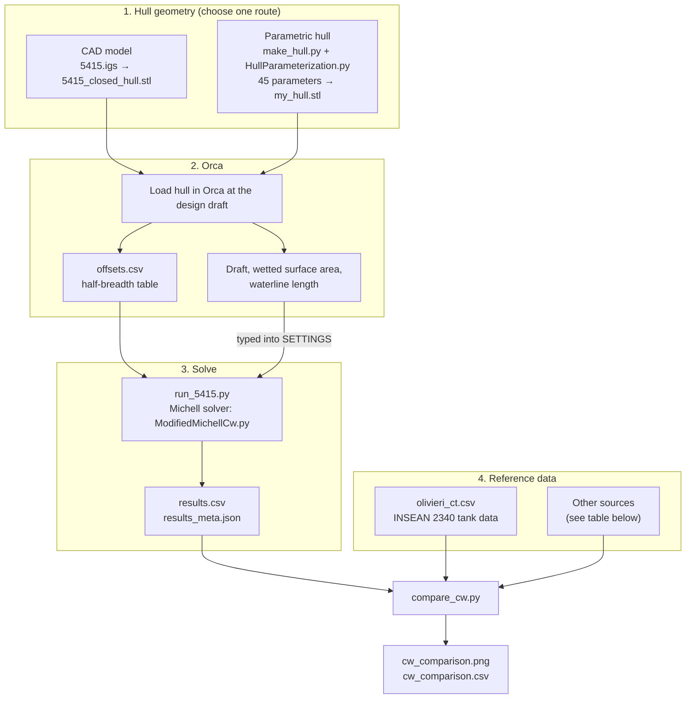

# Michell-Method-for-DTMB-5415-Hull-Types
## Project Overview

This repository contains the computational framework, code, and steps taken to evaluate the wave-making resistance of a modified Model DTMB 5415 hull form using Michell's integral theory and its assumptions. 

The primary objective of this project is to implement Michell's thin-ship integral using python code to evaluate wave resistance across a variety of Froude numbers, comparing potential flow predictions against established CFD datasets and experimental towing tank benchmark data. 

---

## Table of Contents

- [How it works](#how-it-works)
- [Repository layout](#repository-layout)
- [Quick start](#quick-start-cad)
- [Inputs](#inputs)
- [Outputs](#outputs)
- [Results](#results)
- [Notes and limitations](#notes-and-limitations)
- [Credits](#credits)

---

## How it works



### Step by step
 
1. **Build the hull** by one of two routes:
   - **CAD route:** model the hull in CAD and export a closed hull. This repo includes `5415_closed_hull.stl`, made from `5415.igs`.
   - **Parametric route:** set the 45-element parameter vector in `make_hull.py` and run it. `HullParameterization.py` writes a closed STL (`my_hull.stl`).
2. **Load the hull into Orca**, whichever route made it. At the design draft, read off the **draft**, **wetted surface area** and **waterline length**, and export the half-breadth table as `offsets.csv`.
3. **Run the solver.** Type the three Orca numbers into the SETTINGS block of `run_5415.py` and run it. For each Froude number it calls `ModMichell()`, which evaluates the Michell wave-resistance integral (Filon quadrature in `z` and `x`, then a trapezoidal integral over the wave propagation angle `θ`). `Rw` is converted to `Cw`, and a total coefficient `Ct` is built from the ITTC-1957 friction line and a form factor.
4. **Compare with reference data.** `compare_cw.py` removes friction from the tank data to get an experimental `Cw`, interpolates it to the same Froude numbers, and plots and tabulates it against the Michell prediction.

### Reference data used for comparison
 
| Source | What it provides | Status |
|---|---|---|
| DTMB 5415 model, INSEAN 2340 (Olivieri et al.) | Measured total resistance coefficient `CTM` vs. Froude number, in `olivieri_ct.csv` | Wired into `compare_cw.py` |
| *Add source 2* | *e.g. what it is, where it comes from, which quantity (Cw, Ct, Rt)* | *Planned* |
| *Add source 3* | | *Planned* |
 
Because every hull passes through Orca, the same solver and the same comparison scripts work for any hull. A hull whose dimensions differ from the reference 5415 by more than 10% triggers a warning in `compare_cw.py`, and the plot is labelled as reference only.
 
 
### Step by step
 
1. **Build the hull** by one of two routes:
   - **CAD route:** model the hull in CAD and export a closed hull. This repo includes `5415_closed_hull.stl`, made from `5415.igs`.
   - **Parametric route:** set the 45-element parameter vector in `make_hull.py` and run it. `HullParameterization.py` writes a closed STL (`my_hull.stl`).
2. **Load the hull into Orca**, whichever route made it. At the design draft, read off the **draft**, **wetted surface area** and **waterline length**, and export the half-breadth table as `offsets.csv`.
3. **Run the solver.** Type the three Orca numbers into the SETTINGS block of `run_5415.py` and run it. For each Froude number it calls `ModMichell()`, which evaluates the Michell wave-resistance integral (Filon quadrature in `z` and `x`, then a trapezoidal integral over the wave propagation angle `θ`). `Rw` is converted to `Cw`, and a total coefficient `Ct` is built from the ITTC-1957 friction line and a form factor.
4. **Compare with reference data.** `compare_cw.py` removes friction from the tank data to get an experimental `Cw`, interpolates it to the same Froude numbers, and plots and tabulates it against the Michell prediction.


## Repository layout

| File | Purpose |
|---|---|
| `ModifiedMichellCw.py` | Michell solver (`ModMichell`), plus helpers `michspace`, `CalcDrag`, `Calc_Cf`, `interp_CW`. Python port of Douglas Read's MATLAB code. |
| `run_5415.py` | Main run script. Reads `offsets.csv`, sweeps Froude number, writes `results.csv` and `results_meta.json`. |
| `compare_cw.py` | Compares the Michell prediction with tank data. Writes `cw_comparison.png` and `cw_comparison.csv`. |
| `HullParameterization.py` | Parametric hull generator (`Hull_Parameterization` class). 45 input parameters. Original hull workflow only. |
| `make_hull.py` | Example driver for `HullParameterization.py`. Writes an STL. |
| `5415_closed_hull.stl` | Closed binary STL of the DTMB 5415 hull made in CAD (from `5415.igs`). |
| `olivieri_ct.csv` | Tank data for the 5415 model: `Fr, CTM, Re, CF`. |
| `cw_comparison.csv` | Example output of `compare_cw.py` for the CAD hull. |
| `offsets.csv` | *You supply this.* Half-breadth offsets exported from Orca (format below). |

---

## Requirements

- Python 3 (tested with numpy 2.5, scipy 1.18, matplotlib 3.11)
- `numpy`
- `scipy` (used by `run_5415.py` for `RegularGridInterpolator`)
- `matplotlib` (used by `compare_cw.py`)
- `numpy-stl` (only for `HullParameterization.py` / `make_hull.py`)

```bash
pip install numpy scipy matplotlib numpy-stl
```

All scripts must be run from the same folder, because they import and read each other by filename.

---

## Hull workflows

### A. CAD hull + Orca offsets (used for the final results)

1. Model the hull in CAD and export the closed hull (this repo includes `5415_closed_hull.stl`, built from `5415.igs`).
2. Load the hull in Orca and read off three numbers at the design draft: **draft**, **wetted surface area**, and **waterline length**.
3. Export the half-breadth offset table from Orca as `offsets.csv`.
4. Continue with the [quick start](#quick-start-cad--orca-workflow).

### B. Parametric hull (original approach)

`HullParameterization.py` generates a hull from a 45-element parameter vector, grouped into five blocks: general hull form, parallel mid-body cross section, bow form, stern form, and bulb forms (bow and stern bulbs follow Chrismianto and Kim, 2014).

`make_hull.py` shows how to use it:

```python
import numpy as np
from HullParameterization import Hull_Parameterization as HP

v = np.array([...], dtype=np.float64)   # 45 numbers
print(len(v))                           # must print 45

Hull = HP(v)
mesh = Hull.gen_stl(NUM_WL=100, PointsPerWL=800,
                    bit_AddTransom=1, bit_AddDeckLid=1,
                    namepath='./my_hull')   # writes my_hull.stl
```

Useful methods on the `Hull_Parameterization` object:

| Method | Returns |
|---|---|
| `gen_stl(NUM_WL, PointsPerWL, bit_AddTransom, bit_AddDeckLid, bit_RefineBowAndStern, namepath)` | Writes `<namepath>.stl` and returns the mesh. |
| `gen_PC_for_Cw(draft, NUM_WL, PointsPerWL)` | `X, Z, Y, WL`: the point grid in the form `ModMichell` expects (`Y` indexed `[x, z]`). |
| `Calc_VolumeProperties()` | Fills in waterplane area, volume, centres of buoyancy/flotation, second moments, wetted surface and waterline length for a range of drafts. |
| `input_Constraints()` | Constraint values for the 45 parameters, for checking a design is geometrically valid. |

The parametric hull was not accurate enough to reproduce the 5415, which is why workflow A was adopted. The code is kept here because it works and is reusable for other hulls.

---

## Quick start (CAD / Orca workflow)

1. Put `offsets.csv` and `olivieri_ct.csv` in the same folder as the scripts.
2. Open `run_5415.py` and edit the **SETTINGS** block at the top (see [Inputs](#inputs)). At minimum, set `DRAFT_ORCA`, `S_ORCA` and `LWL_ORCA` from Orca.
3. Run the solver:

   ```bash
   python run_5415.py
   ```

   This prints a table as it goes and writes `results.csv` and `results_meta.json`.
4. Compare with the tank data:

   ```bash
   python compare_cw.py
   ```

   This writes `cw_comparison.png` and `cw_comparison.csv` and opens the plot.

**Run time.** The solver uses pure-Python loops over `NX × NZ × N_ANGLES` for every speed. With the default grid (301 × 51 × 400) and 41 Froude numbers, expect on the order of 10–20 minutes (extrapolated from a small test run; your machine will differ). For a quick test, lower `NX`, `NZ`, `N_ANGLES` and widen `FN_STEP`.

---

## Inputs

### `offsets.csv`

A plain comma-separated file, no text header, in metres, **half-breadths** (one side of the hull only):

|  | depth₁ | depth₂ | … | depthₘ |
|---|---|---|---|---|
| `0` | `0` | `z₂` | … | `T` |
| `x₁` | `y(x₁, 0)` | `y(x₁, z₂)` | … | `y(x₁, T)` |
| `x₂` | … | … | … | … |
| … | | | | |

- **Row 0:** the first value is a placeholder `0`, followed by depths below the waterline in ascending order. The first depth must be `0` and the last must equal the draft.
- **Rows 1…:** the first column is the longitudinal position `x`, followed by the half-breadth at each depth.
- `x` and depth must be strictly increasing, and there must be no blank cells.

The script stops with a clear error if any of these are violated, or if the deepest depth differs from `DRAFT_ORCA` by more than 1% (usually a sign of the wrong file or wrong units).

### Settings in `run_5415.py`

| Setting | Default | Meaning |
|---|---|---|
| `OFFSETS_FILE` | `"offsets.csv"` | Offsets file described above. |
| `DRAFT_ORCA` | `0.2477` | Draft in metres. Must equal the last depth in `offsets.csv`. |
| `S_ORCA` | `4.573` | Wetted surface area from Orca at that draft (m²). Used to non-dimensionalise `Rw`. |
| `LWL_ORCA` | `5.7271` | Waterline length from Orca (m). `None` uses the x-range of `offsets.csv`. Sets speed through `U = Fn·√(gL)`. |
| `RHO` | `998.0` | Water density (kg/m³). Freshwater tank: about 998. Seawater: about 1025. |
| `NU` | `1.004e-6` | Kinematic viscosity (m²/s), used for the friction line. |
| `G` | `9.81` | Gravity (m/s²). Also written into the solver. |
| `K_FORM` | `0.15` | Form factor `k` in `Ct = (1+k)·CF + Cw`. |
| `FN_START, FN_STOP, FN_STEP` | `0.05, 0.45, 0.01` | Froude number sweep (41 speeds). |
| `NX` | `301` | Longitudinal grid points. **Must be odd** (Filon rule). |
| `NZ` | `51` | Vertical grid points. |
| `N_ANGLES` | `400` | Wave propagation angles for the `θ` integral. |
| `RESULTS_FILE, META_FILE` | `results.csv`, `results_meta.json` | Output names. |

### Settings in `compare_cw.py`

| Setting | Default | Meaning |
|---|---|---|
| `EXP_FILE` | `"olivieri_ct.csv"` | Tank data (columns `Fr, CTM, Re, CF`). |
| `OFFSETS_FILE`, `RESULTS_FILE`, `META_FILE` | as in `run_5415.py` | Must match the run you want to compare. |
| `K_EXP` | `0.15` | Form factor used to strip friction from the tank data. `None` estimates it with a Prohaska fit. |
| `PROHASKA_FR` | `(0.15, 0.20)` | Froude range for the Prohaska fit. |
| `REF_L, REF_B, REF_T` | `5.72, 0.76, 0.248` | Reference 5415 model dimensions. Only used to warn if your hull is a different shape. |
| `OUT_PNG`, `OUT_CSV` | `cw_comparison.png`, `cw_comparison.csv` | Output names. |

### `olivieri_ct.csv`

Experimental data for the DTMB 5415 model (INSEAN 2340). Header `Fr,CTM,Re,CF`: Froude number, measured total resistance coefficient, Reynolds number, and friction coefficient. Repeat runs at the same Froude number are averaged.

---

## Outputs

### `results.csv` (from `run_5415.py`)

One row per Froude number.

| Column | Meaning |
|---|---|
| `Fn` | Froude number, `U/√(gL)` |
| `U_m_per_s` | Ship speed (m/s) |
| `Rw_N` | Michell wave resistance (N) |
| `Cw` | Wave resistance coefficient, `Rw / (½ρU²S)` |
| `CF` | ITTC-1957 friction coefficient, `0.075 / (log₁₀(Re) − 2)²` |
| `Ct` | Total resistance coefficient, `(1+k)·CF + Cw` |

The script also prints the hull length, draft, maximum beam, volume and block coefficient `Cb`. **Check `Cb` against Orca's block coefficient.** A mismatch means the offsets were read or interpolated incorrectly.

### `results_meta.json`

Hull properties saved so the comparison script does not need them typed in again:

```json
{
  "hull_id": "5d2af041ce",
  "S": 4.573,
  "L": 5.7271,
  "T": 0.2477,
  "B": 0.78,
  "rho": 998.0,
  "k": 0.15
}
```

`hull_id` is a hash of `offsets.csv`. `compare_cw.py` refuses to run if `offsets.csv` has changed since the results were produced (`STALE: offsets.csv changed...`), so results and hull cannot silently get out of sync. (The values above are an example.)

### `cw_comparison.csv` (from `compare_cw.py`)

| Column | Meaning |
|---|---|
| `Fn` | Froude number |
| `Cw_Michell` | Michell wave-resistance coefficient |
| `Cw_exp` | Experimental `Cw` = `CTM − (1+k)·CF`, interpolated to the same Froude numbers |
| `Ct_Michell` | Michell total resistance coefficient |

### `cw_comparison.png`

Two panels: wave resistance coefficient `Cw` (Michell vs. tank) on the left, and total resistance coefficient `Ct` (Michell vs. tank `CTM`) on the right. If the hull dimensions differ from the reference 5415 by more than 10%, a warning is printed and the figure title notes that the tank curve is for reference only.

---

## Results


## Notes and limitations

- **Thin-ship theory** assumes a slender hull, so accuracy drops for full or beamy forms, and it commonly over-predicts wave resistance, which is consistent with the results above. It also ignores viscous effects, trim and sinkage, and the transom stern.
- **Floating-point warnings.** You may see `RuntimeWarning: overflow` messages from `ModifiedMichellCw.py`. They come from the `θ = π/2` end point, where `sec θ` is enormous. The affected values are zeroed with `np.nan_to_num`.
- **Draft must match.** Always set `DRAFT_ORCA`, `S_ORCA` and `LWL_ORCA` from the same Orca hull and draft that produced `offsets.csv`.

---

## Credits


